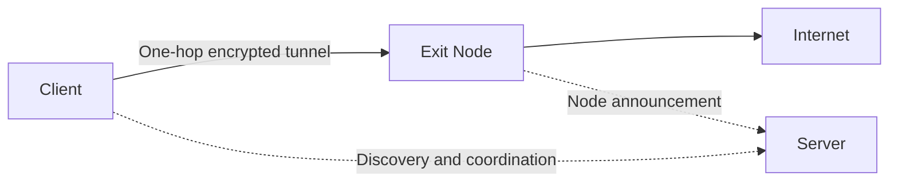
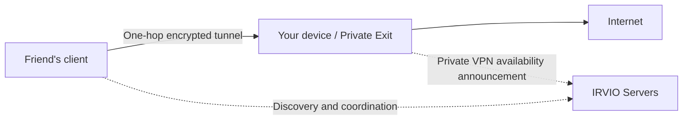

<h1 align="center">&nbsp;&nbsp;IRVIO PROJECT</h1>

<p align="center">
  <strong>OPEN SOURCE · ONE-HOP · PEER-TO-PEER VPN</strong>
</p>

<p align="center">
  
  
  
  
  
  <a href="LICENSE"></a>
</p>

<p align="center">
  An open, distributed network where participants provide internet access to one another — without a central VPN gateway.
</p>

<p align="center">
  <a href="https://irvio.net">Website</a> ·
  <a href="#quick-start">Quick Start</a> ·
  <a href="#private-vpn">Private VPN</a> ·
  <a href="#architecture">Architecture</a> ·
  <a href="#contributing">Contributing</a>
</p>

<p align="center">English · <a href="README_RU.md">Русский</a></p>

> [!WARNING]
> In **Global VPN**, connecting also turns your device into an Exit Node for other participants. Their traffic may reach the internet through your public IP address. In **Private VPN**, you choose separately whether to share your connection with friends or connect through a friend. Friends you grant access to will also reach the internet through your public IP. Only share invitations with people you trust.

<a id="about"></a>

Here's the network bootstrap link. It introduces you to the IRVIO network — it is **not** a Private VPN invitation:

```text
irvio-bootstrap:v1:CAEaQQo0MTJEM0tvb1c5dnFiQTdNRm5MYkZQS3VWNTc1VTNtNXY1Tm00SDZMcml4UXkzUnFZNmV4cxIJCgTCVzSkEKAfGkEKNDEyRDNLb29XQXFKTVNGZTJ1MkxBa1JUQXdCenFXQUQ5TUZQejFrQ2tKdWt0QWJtakxEaG4SCQoEwHy16RCgHxpBCjQxMkQzS29vV1BFS3ZTV1BZc3FpZlZNcVBKYk1UY0xLR1E4bzljRkM2b3hzcDl1Z1RLaDJMEgkKBE4R0SkQoB8
```

## What is IRVIO?

Start with our [manifesto](https://irvio.net/?lang=en) — it explains why IRVIO exists!

IRVIO is a free, open-source VPN network. Instead of relying on one VPN provider's infrastructure, the client establishes a direct encrypted tunnel to another participant — an **Exit Node**. Your traffic reaches the internet through that node's connection and public IP address.

The service infrastructure is separate from the path your traffic takes. **Servers** help participants find one another, get through NAT, and establish direct connections. They do not act as intermediate relays between the client and a separate Exit Node.

### Two ways to use IRVIO

| Mode | What you choose | Who provides internet access |
|---|---|---|
| **Global VPN** | The exit country | A suitable Exit Node found in the network |
| **Private VPN** | A saved connection to a friend | The specific friend sharing their connection |

Both modes work in the **Ubuntu and Windows 11 clients** (well, those are the systems we've actually tested; Windows 10 will probably work just fine too). Both use a direct, one-hop encrypted tunnel. A Windows client can connect to a Linux host, and vice versa.

### Taking part in Global VPN

IRVIO doesn't belong to any one party and doesn't run a centralized fleet of exit servers. So when you join the network, you use other participants' Exit Nodes and share your own internet connection in return. That exchange is what keeps the network free and distributed.

Other people's Exit Nodes work for you; yours works for them.

<a id="architecture"></a>

## How it works

IRVIO has two functional roles. A device can perform either one or both at the same time. The architecture is fairly simple on purpose — we didn't want to build a second Tor. Deep anonymity wasn't a goal of the project, either.

### Global VPN



### Exit Node

An Exit Node is a regular network participant. It can use IRVIO for its own traffic while also sharing its internet connection with other participants. The encrypted tunnel ends at the Exit Node, and from there traffic reaches the internet through that node's connection.

### Server

A Server provides IRVIO's distributed service infrastructure: peer discovery, Kademlia/DHT, Rendezvous, and other coordination mechanisms. To remain reliably reachable, it needs a public IP address or stable forwarding of the required inbound ports. A Server is not a relay between the client and a separate Exit Node. But the same machine can be both a Server and an Exit Node. If a client selects that machine as its exit, the tunnel ends directly on it.

### Choosing an exit in Global VPN

You don't need to compare node IP addresses or settings. Just choose a country: the client gets suitable candidates, checks them from your device, and connects to a reachable Exit Node. Discovery doesn't depend on a single central server. If a connection to one candidate fails, the client moves on to the next available option.

<a id="private-vpn"></a>

## Private VPN — directly through a friend's internet connection

Private VPN is for when you already know who you want to connect to. Instead of choosing a country and a public Exit Node, you use an invitation from a friend. Your traffic goes out through their internet connection.



Just like in Global VPN, servers help devices find one another and establish a connection, while user traffic travels directly between the devices. Private VPN still relies on IRVIO's discovery infrastructure, though: it is not a standalone, serverless VPN. Whether a direct connection can be established depends on the networks and NAT on both sides, so it isn't guaranteed to work everywhere (our rough guess is that things should work out in about 90% of cases; symmetric NAT can be a problem, although we don't encounter it all that often).

### Share your internet connection

1. Install IRVIO and import the network bootstrap link if you haven't already (you'll find it at the top of this README).
2. Open **Private VPN** and click **Share my internet**.
3. In the invitation window, copy the link or save the QR code. Send it directly to your friend.
4. Keep IRVIO running and sharing enabled. When your friend connects, you'll see their connection on this screen.
5. If you have a Linux host (a VDS, an always-on VM, or something similar), you can use **`--persistent`** to keep the Exit Node running there, even after a reboot.

An invitation can be used for **one hour**. The first device to use it gets access automatically — no separate approval is needed. The link and QR code grant access, so don't post them in public chats.

That one-hour limit applies to the **first use of the invitation**, not to the permission once it's been saved. Afterward, your friend can reconnect without a new link for as long as you're sharing your connection and haven't revoked their access.

**Invite another friend** creates a new invitation. **Stop sharing** stops sharing your connection. **Revoke access** removes a particular friend's permission to use it.

### Connect through a friend's internet connection

1. Install IRVIO and import the network bootstrap link to access the discovery infrastructure (it's at the top of this README).
2. Open **Private VPN → Connect to a friend**.
3. Paste your friend's invitation or click **Import QR image**, then **CONNECT**.
4. Wait for **CONNECTED**. Your traffic now reaches the internet through your friend's connection.

The connection will be saved in the dropdown list with an abbreviated PeerID. Next time, just select it and click **CONNECT** — there's no need to use the original invitation again. **DISCONNECT** restores your normal internet connection.

To remove a saved connection to a friend from your own device, open the corresponding friend-profile removal section in **Settings**. This is a separate action: it isn't the same as deleting your main IRVIO profile or revoking access on the device that's sharing its connection.

### What exactly does your friend get access to?

This mode provides **internet access**, not access to your local network, files, RDP, or VNC. It doesn't turn a friend's home network into a remote-access network.

The current UI keeps these actions separate: Global VPN with connection sharing, connecting to a friend, or private sharing on its own. While you're connected through a friend, **Share my internet** is unavailable. Private VPN doesn't build chains of multiple VPN hops.

### Sharing IRVIO network links

If you need to share IRVIO or give someone a link to join the network, don't use the bootstrap link from this repository. There are lots of bootstrap servers, and the list changes frequently. To share the current list of available servers, open **Share IRVIO** in the UI, generate a fresh QR code or network bootstrap link, and send it to whoever needs it.

<a id="privacy"></a>

## Privacy and the limits of the model

IRVIO doesn't use a single central VPN gateway.

- Traffic between the client and the selected Exit Node travels through an encrypted tunnel.
- Beyond that tunnel, the usual VPN model applies: the Exit Node may see destination addresses, and external services see its public IP.
- A Server handles discovery and coordination, but doesn't become a third transit node between the client and the Exit Node.
- Independent operators manage their own systems and logging policies.
- Local diagnostic logs may contain PeerIDs and network addresses.
- Private VPN lets you choose an Exit operator you trust, but it doesn't hide your traffic from that operator or replace HTTPS. Keep invitation links and QR codes private.

Don't publish logs, dumps, or other diagnostic data in Issues without checking what they contain first.

<a id="technology"></a>

## Technology behind IRVIO

| Component | Purpose |
|---|---|
| **AmneziaWG** | An obfuscated encrypted tunnel based on WireGuard |
| **go-libp2p** | P2P connectivity and node identity |
| **Kademlia / DHT** | Distributed discovery of participants and node announcements |
| **Rendezvous, STUN, and ICE** | Peer discovery and establishing connections through NAT |
| **One-hop traffic path** | Traffic goes directly from client to Exit Node |
| **systemd** | Daemon and server service management on Ubuntu |
| **Windows services / WFP** | Daemon lifecycle and ProtectedMode on Windows |

IRVIO encryption protects the connection between the client and the Exit Node. Once traffic leaves the tunnel, external services see that node's IP, and keeping the content confidential still depends on HTTPS or other end-to-end encryption at the application layer.

<a id="quick-start"></a>

## Quick Start

It really is quick! First, download the latest release for your platform. After that, you've got a couple of options!

### Ubuntu desktop client

Extract the tarball and run this from a terminal as your regular user:

```bash
sudo ./install.sh --user "$USER"
```

The installer adds the dependencies, daemon, UI, and system services. You can open IRVIO right away — no need to log out or reboot. The Local API socket is available to the selected user's UID, which the daemon also checks using `SO_PEERCRED`. Then just open **IRVIO** from your applications menu or run:

```bash
irvio
```

The daemon starts automatically when you open the UI. Next:

1. Import the current network bootstrap link or QR code (the link is at the top of this README).
2. Open **Global VPN** and wait for the list of countries.
3. Choose an exit country.
4. Click **CONNECT**.

You don't need to start the daemon manually.

> [!IMPORTANT]
> Don't run the UI with `sudo`. Importing a bootstrap code doesn't start the VPN by itself: the tunnel comes up after you choose a country and click **CONNECT**.

### Windows 11 desktop client

1. Download the Windows x64 installer for your chosen release and verify its checksum.
2. Run the installer and approve the administrator prompt to install the daemon, driver, and system components.
3. Open **IRVIO** from the Start menu as a regular user, or from the desktop if you asked the installer to create a shortcut there.
4. Import the network bootstrap link or QR code (same place as before — at the top of this README).
5. Choose a country in **Global VPN**, or open **Private VPN** to share your connection or connect to a friend.

You don't need to start the daemon manually or keep the UI running as administrator. The Windows installer may be an unsigned preview build: check the notes for your specific release, and don't assume it has a publisher signature, automatic updates, or installation recovery. Before removing or replacing it, exit through **Shutdown IRVIO**.

### Ubuntu: share privately without leaving the UI open (temporary)

After installing IRVIO for your user, run one of these commands as that user:

```bash
irvio --mode client --bootstrap 'irvio-bootstrap:v1:<FULL_BUNDLE>'
irvio --mode client --bootstrap /path/to/bootstrap.txt
irvio --mode client --bootstrap /path/to/bootstrap-QR.png
```

Replace `<FULL_BUNDLE>` with the complete network bootstrap link, and replace the paths with your own. You can provide the link itself, a text file, or a PNG/JPEG QR-code image. This command enables **Share my internet**, not Global VPN. The installed daemon is started through the Local API; the console binary does not replace installing the daemon and services. A file named `irvio-invitation-<number>.txt`, accessible only to its owner, will appear in the current directory. Send the link from that file to your friend: just like in the UI, the invitation is valid for one hour and grants access to the first device that uses it.

Keep the command running while you're sharing. **Ctrl+C** stops sharing cleanly without deleting your profile or your friends' permissions. The next run creates a new invitation file. Force-killing the console doesn't stop the daemon — if that happens, stop sharing through the UI. Don't manage the same session from the console and UI at the same time.

### Ubuntu: share privately without leaving the UI open (persistent)

A kind of pseudo-VPN that doesn't necessarily need a public IP address.

It's the same as temporary private sharing without the UI, except you add the **`--persistent`** option when starting it. You'll get an invitation link as usual; pass it to your friend. After that, you can close the terminal — the daemon and required services keep running. If the machine reboots for whatever reason, everything starts automatically again and internet sharing for your friend is restored.

### Server without a UI

First things first: servers are what hold the whole network together. More servers generally mean a more resilient network. As a rule, a Server doesn't carry client traffic, with one exception: if it's the only Exit Node in a country. In that case, the Server itself handles traffic for people who choose that country as their exit.

Installation is straightforward:

```bash
sudo ./install.sh \
  --role server \
  --bootstrap 'irvio-bootstrap:v1:<FULL_BUNDLE>'
```

Replace `<FULL_BUNDLE>` with the complete, up-to-date bootstrap link from the official connection page.

The installer adds dependencies, configures the service and its automatic startup, launches the Server, and checks that it's ready. On success, you'll see:

```text
IRVIO server: OK
```

If something goes wrong, the installer shows the reason and diagnostic commands. This command is for a fresh installation: it deliberately won't overwrite an unknown manual deployment.

<a id="server-ports"></a>

## Server network ports

A standard Server installation uses these external ports:

| Protocol and port | Purpose |
|---|---|
| `TCP/4000` | Bootstrap / libp2p |
| `UDP/3478` | STUN |
| `UDP/51820` | ICE / AmneziaWG |

The installer configures UFW if it's active. If your hosting provider has a separate firewall, allow these ports there too. The installer won't overwrite custom firewall rules.

Check the documentation for your particular release before deployment: network settings may still change during alpha.

<a id="diagnostics"></a>

## Diagnostics

On **Ubuntu**, IRVIO's main logs are in the **systemd journal**, not a separate `irvio.log` file. The commands below are for Ubuntu, not Windows. On either platform, you can start with the **Diagnostics** screen and the instructions for your build.

Last 100 client-daemon entries:

```bash
sudo journalctl -u irviod.service -n 100 --no-pager
```

Live client-daemon logs:

```bash
sudo journalctl -u irviod.service -f
```

Last 100 Server entries:

```bash
sudo journalctl -u irvio-server.service -n 100 --no-pager
```

Live Server logs:

```bash
sudo journalctl -u irvio-server.service -f
```

Run the Server readiness check again:

```bash
sudo /opt/irvio/scripts/check-server.sh
```

Check logs before sharing them publicly: they may contain PeerIDs and network addresses.

<a id="contributing"></a>
<a id="project-status"></a>

## How to help the project

You can help with code, testing, documentation, or network infrastructure.

### Run a node

One of the most useful contributions is an always-available Server or Exit Node in your country. That expands the network's geographic reach, improves peer discovery, and makes IRVIO more resilient.

Public node operators are responsible for updates, proper firewall configuration, monitoring, and compliance with applicable laws and requirements.

### Contribute to development

We'd be happy to hear from developers interested in IRVIO. Improvements to the Linux and Windows clients, work on future **macOS, iOS, and Android** clients, testing, documentation, and infrastructure are all especially welcome.

Before your first Pull Request, please open an Issue briefly describing the change. That makes it easier to agree on an approach and avoid duplicated work.

<a id="contact"></a>

## Contact

- Website: [irvio.net](https://irvio.net)
- Repository: [github.com/Irviodotnet/Irvio](https://github.com/Irviodotnet/Irvio)
- Email: [irvio@proton.me](mailto:irvio@proton.me)

---

<p align="center">
  <strong>IRVIO is built by people, for people.</strong><br>
  The more participants, the wider and more resilient the network becomes.
</p>
