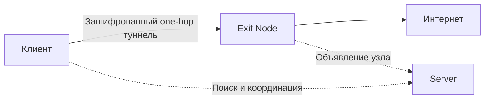

<h1 align="center">&nbsp;&nbsp;IRVIO PROJECT</h1>

<p align="center">
  <strong>OPEN SOURCE · ONE-HOP · PEER-TO-PEER VPN</strong>
</p>

<p align="center">
  Открытая распределённая сеть, в которой участники помогают друг другу получать доступ к интернету без единого центрального VPN-шлюза.
</p>

<p align="center">
  <a href="https://irvio.net">Сайт</a> ·
  <a href="#быстрый-старт">Быстрый старт</a> ·
  <a href="#как-это-работает">Архитектура</a> ·
  <a href="#участие-в-разработке">Участие в разработке</a>
</p>

> [!WARNING]
> Подключаясь к IRVIO, вы не только используете чужую точку выхода, но и становитесь Exit Node для других участников. Их интернет-трафик может выходить через ваш публичный IP-адрес. Перед запуском ознакомьтесь с принципом работы сети и применимым законодательством.

## Что такое IRVIO

IRVIO — бесплатная VPN-сеть с открытым исходным кодом. Вместо маршрута через инфраструктуру одного провайдера клиент устанавливает прямой зашифрованный туннель до выбранного участника сети — **Exit Node**. В интернет трафик выходит уже через подключение и IP-адрес этого узла.

Служебная инфраструктура отделена от передачи пользовательских данных. Узлы **Server** помогают участникам обнаружить друг друга, пройти NAT и установить прямое соединение, но в штатном режиме не находятся в пути пользовательского трафика.

Проект находится на ранней стадии разработки. Первая поддерживаемая платформа — **Ubuntu 24.04 LTS, AMD64**. Интерфейсы, протоколы и формат установки до стабильного релиза могут меняться.

## Как это работает



IRVIO использует две функциональные роли. Один узел может выполнять одну или обе роли одновременно.

### Exit Node

Обычный участник сети. Он может использовать IRVIO для собственного трафика и одновременно предоставлять часть своего интернет-подключения другим участникам. Туннель завершается на Exit Node, после чего трафик выходит в интернет через его сетевое подключение.

### Server

Узел служебной инфраструктуры. Он участвует в peer discovery, Kademlia/DHT, Rendezvous и других координационных механизмах, которые помогают участникам найти друг друга и установить прямое соединение. Для стабильной доступности Server требуется публичный IP-адрес либо постоянно проброшенный входящий порт.

Server также может использовать сеть для собственного трафика и одновременно работать как Exit Node.

## Техническая основа

| Компонент | Назначение |
|---|---|
| **AmneziaWG** | Зашифрованный туннель на основе WireGuard с обфускацией |
| **libp2p** | Одноранговое сетевое взаимодействие |
| **Kademlia / DHT** | Распределённое обнаружение и хранение объявлений узлов |
| **Rendezvous и STUN** | Поиск участников и помощь в установлении соединения через NAT |
| **One-hop data plane** | Пользовательский трафик идёт напрямую от клиента к Exit Node |
| **systemd** | Управление daemon и серверной службой в Ubuntu |

Шифрование IRVIO защищает участок между клиентом и Exit Node. После выхода из туннеля действует обычная модель VPN: внешние сервисы видят IP-адрес точки выхода, а конфиденциальность прикладных данных по-прежнему зависит от HTTPS и других протоколов сквозного шифрования.

## Быстрый старт

Скачайте официальный архив релиза и проверьте опубликованную контрольную сумму. Затем распакуйте архив и перейдите в его каталог.

### Клиент с UI

В терминале обычного пользователя:

```bash
sudo ./install.sh --user "$USER"
```

После установки выйдите из пользовательского сеанса и войдите снова, чтобы применилось членство в группе доступа. Запустите **IRVIO** из меню приложений или командой:

```bash
irvio
```

Daemon запустится автоматически при открытии UI. Далее импортируйте bootstrap-код, выберите страну и нажмите **CONNECT**. Запускать daemon вручную не требуется.

> [!IMPORTANT]
> Не запускайте графический интерфейс через `sudo`.

### Server без UI

```bash
sudo ./install.sh \
  --role server \
  --bootstrap 'hydra-bootstrap:v1:<ПОЛНЫЙ_BUNDLE>'
```

Установщик добавит зависимости, настроит службу и её автозапуск, запустит сервер и проверит готовность. При успешной проверке он выведет:

```text
IRVIO server: OK
```

Команда предназначена для новой установки. Установщик намеренно не перезаписывает неизвестную ручную установку.

Полная инструкция по установке, первому подключению и диагностике доступна [на сайте IRVIO](https://irvio.net/installation.html?lang=ru).

## Сетевые порты Server

| Протокол и порт | Назначение |
|---|---|
| `TCP/4000` | Bootstrap / libp2p |
| `UDP/3478` | STUN |
| `UDP/51820` | ICE / AmneziaWG |

Активный UFW настраивается установщиком. Правила firewall в панели хостинг-провайдера необходимо разрешить отдельно. Нестандартные правила firewall установщик не перезаписывает.

## Диагностика

Основные журналы IRVIO находятся в **systemd journal**, а не в отдельном файле `irvio.log`.

Клиент с UI:

```bash
sudo journalctl -u hydrad.service -f
```

Server:

```bash
sudo journalctl -u irvio-server.service -f
sudo /opt/irvio/scripts/check-server.sh
```

Имя `hydrad.service` сохранено для совместимости. Перед публикацией диагностических журналов проверьте их содержимое: в них могут находиться PeerID и сетевые адреса.

## Приватность

IRVIO не требует единого оператора трафика и не использует центральный VPN-шлюз. При этом децентрализация не означает абсолютную анонимность:

- выбранный Exit Node видит направления исходящих соединений в пределах стандартной VPN-модели;
- Server обрабатывает служебные сообщения обнаружения и координации;
- независимые операторы узлов контролируют собственные системы и политики журналирования;
- локальные журналы daemon остаются на устройстве, пока пользователь сам их не передаст.

Не отправляйте в Issues журналы или диагностические данные, не проверив их содержимое.

## Статус проекта

Сейчас IRVIO готовится к первому публичному Linux-релизу. Текущий фокус:

- клиент с UI для Ubuntu;
- headless Server для распределённой инфраструктуры;
- устойчивое обнаружение узлов и прямые P2P-соединения;
- расширение географии Exit Node;
- тестирование установки, обновления и восстановления после сбоев.

Поддержка Windows, macOS, Android и iOS находится в планах и будет добавляться по мере готовности соответствующих клиентов.

## Участие в разработке

Мы приглашаем разработчиков присоединиться к IRVIO. Особенно полезен вклад в создание клиентов для **iOS, Android и macOS**, а также в тестирование, документацию и развитие сетевой инфраструктуры.

Перед первым Pull Request откройте Issue и кратко опишите предлагаемое изменение — так будет проще согласовать архитектуру и избежать дублирования работы.

## Безопасность

Не публикуйте сведения об уязвимостях в открытых Issues. Для непубличного сообщения напишите на [irvio@proton.me](mailto:irvio@proton.me) и укажите в теме письма `SECURITY`.

## Лицензия

Исходный код IRVIO распространяется на условиях **GNU Affero General Public License v3.0**. Полный текст находится в файле [`LICENSE`](LICENSE).

## Контакты

- Сайт: [irvio.net](https://irvio.net)
- Репозиторий: [github.com/Irviodotnet/Irvio](https://github.com/Irviodotnet/Irvio)
- Email: [irvio@proton.me](mailto:irvio@proton.me)

---

<p align="center">
  <strong>IRVIO создаётся людьми и для людей.</strong><br>
  Чем больше участников — тем шире география и устойчивее сеть.
</p>
