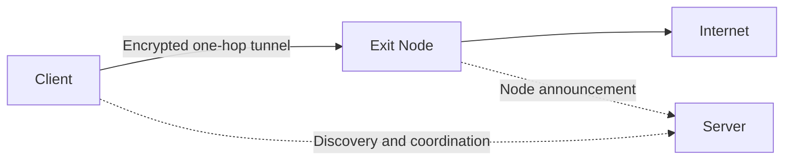

<h1 align="center">&nbsp;&nbsp;IRVIO PROJECT</h1>

<p align="center">
  <strong>OPEN SOURCE · ONE-HOP · PEER-TO-PEER VPN</strong>
</p>

<p align="center">
  
  
  
  
  <a href="LICENSE"></a>
</p>

<p align="center">
  <strong>English</strong> ·
  <a href="README.ru.md">Русский</a>
</p>

<p align="center">
  An open, distributed network where participants provide internet access to one another - without a central VPN gateway.
</p>

<p align="center">
  <a href="https://irvio.net">Website</a> ·
  <a href="#quick-start">Quick Start</a> ·
  <a href="#architecture">Architecture</a> ·
  <a href="#contributing">Contributing</a>
</p>

> [!WARNING]
> When you connect to IRVIO, you do more than use someone else's Exit Node: your device also becomes an Exit Node for other participants. Their internet traffic may leave the network through your public IP address. Before running IRVIO, make sure you understand how the network works, the risks involved, and the laws that apply to you.

<a id="about"></a>

## What is IRVIO?

First of all - Start with our [Manifest](https://irvio.net/?lang=en), it explains why IRVIO exists!  
IRVIO is a free, open-source VPN network. Instead of routing traffic through infrastructure controlled by a single VPN provider, the client establishes a direct encrypted tunnel to another participant - an **Exit Node**. Internet traffic then leaves through that node's connection and public IP address.

The service infrastructure is separated from the user data path. **Server** nodes help participants discover one another, traverse NAT, and establish direct connections, but they do not act as intermediate transit nodes between a client and a separate Exit Node.

### The participation model

IRVIO does not operate a centralized fleet of exit servers. By joining the network, you gain access to Exit Nodes provided by other participants while contributing your own internet connection in return. This mutual exchange is what allows IRVIO to remain free and distributed.

Other people's Exit Nodes work for you; your Exit Node works for others.

The project is currently in **alpha**. The first supported platform is **Ubuntu 24.04 LTS on AMD64**. Interfaces, protocols, and installation procedures may change before the first stable release.

<a id="architecture"></a>

## How it works



IRVIO has two functional roles. A single node may perform either role or both roles at the same time.

### Exit Node

An Exit Node is a regular network participant. It can use IRVIO for its own traffic while sharing its internet connection with other participants. The encrypted tunnel terminates at the Exit Node, and traffic reaches the internet through that node's network connection.

### Server

A Server provides IRVIO's distributed service infrastructure. It participates in peer discovery, Kademlia/DHT, Rendezvous, and other coordination mechanisms that help participants find one another and establish direct connections. To remain reliably reachable, a Server needs either a public IP address or a consistently forwarded inbound port.

A Server is not a relay between a client and a separate Exit Node. However, the same machine may advertise itself as both a Server and an Exit Node. If a client selects that machine as its exit, the one-hop tunnel terminates directly on it.

### One decision for the user

Users do not need to compare IP addresses or inspect individual node parameters. They choose an exit country; the client obtains suitable candidates, tests them directly from the user's device, and connects to an appropriate Exit Node.

Peer discovery does not depend on a single central server. If a connection to one candidate cannot be established, the client moves on to the next available option.

<a id="privacy"></a>

## Privacy and model boundaries

IRVIO does not use a single centralized VPN gateway, but decentralization alone does not guarantee absolute anonymity.

- Traffic between the client and the selected Exit Node travels through an encrypted tunnel.
- Beyond the tunnel, the standard VPN model applies: the Exit Node can observe connection destinations, while external services see the Exit Node's public IP address.
- A Server processes discovery and coordination messages, but it is not a third transit node in the Client → Exit Node connection.
- Independent node operators control their own systems and logging policies.
- Local diagnostic logs may contain PeerIDs and network addresses.

Do not post logs, dumps, or other diagnostic data in Issues before reviewing their contents.

<a id="technology"></a>

## Technical foundation

| Component | Purpose |
|---|---|
| **AmneziaWG** | An encrypted WireGuard-based tunnel with obfuscation |
| **go-libp2p** | Peer-to-peer networking and node identity |
| **Kademlia / DHT** | Distributed discovery of participants and node announcements |
| **Rendezvous, STUN, and ICE** | Peer discovery and connection establishment across NAT |
| **One-hop data plane** | User traffic travels directly from the client to the Exit Node |
| **systemd** | Management of the daemon and Server service on Ubuntu |

IRVIO encryption protects the path between the client and the Exit Node. Once traffic leaves the tunnel, the usual VPN model applies: external services see the Exit Node's IP address, and application-level confidentiality still depends on HTTPS or another end-to-end encryption protocol.

<a id="quick-start"></a>

## Quick Start

Download the archive and its checksum only from the [official Releases page](https://github.com/Irviodotnet/Irvio/releases).

Verify the SHA-256 checksum before extracting the archive. A checksum confirms that the downloaded file is intact, but it does not authenticate the publisher by itself.

The current bootstrap link and QR code are published on the [IRVIO network connection page](https://irvio.net/installation.html?lang=en). Use only bootstrap information published on the official project website.

After verification, extract the archive and change into its directory.

### Client with UI

Run the following command from a regular user's terminal:

```bash
sudo ./install.sh --user "$USER"
```

The installer adds the required dependencies, daemon, UI, and system services. Once installation is complete, sign out of your desktop session and sign back in so the new group membership takes effect.

Launch **IRVIO** from the application menu or run:

```bash
irvio
```

The daemon starts automatically when the UI opens. Then:

1. Import the current bootstrap link or QR code.
2. Wait for the list of available countries.
3. Select an exit country.
4. Press **CONNECT**.

You do not need to start the daemon manually.

> [!IMPORTANT]
> Do not run the UI with `sudo`. Importing a bootstrap code does not connect the VPN; the tunnel starts only after you select a country and press **CONNECT**.

### Headless Server

```bash
sudo ./install.sh \
  --role server \
  --bootstrap 'irvio-bootstrap:v1:<FULL_BUNDLE>'
```

Replace `<FULL_BUNDLE>` with the complete current bootstrap link from the official connection page.

The installer adds the required dependencies, configures and enables the service, starts the Server, and checks whether it is ready. A successful check prints:

```text
IRVIO server: OK
```

If something goes wrong, the installer reports the reason and provides diagnostic commands. This command is intended for a fresh installation; the installer deliberately refuses to overwrite an unknown manual setup.

For complete installation, first-connection, and troubleshooting instructions, see the [IRVIO installation guide](https://irvio.net/installation.html?lang=en).

<a id="server-ports"></a>

## Server network ports

A standard Server installation uses the following externally reachable ports:

| Protocol and port | Purpose |
|---|---|
| `TCP/4000` | Bootstrap / libp2p |
| `UDP/3478` | STUN |
| `UDP/51820` | ICE / AmneziaWG |

The installer configures UFW when it is active. If your hosting provider has a separate firewall, you must allow these ports there as well. The installer does not overwrite custom firewall rules.

Before deployment, compare this table with the documentation for the exact release you are installing. Network parameters may still change during the alpha stage.

<a id="diagnostics"></a>

## Diagnostics

The main IRVIO logs are stored in the **systemd journal**, not in a separate `irvio.log` file.

Show the latest 100 client daemon entries:

```bash
sudo journalctl -u irviod.service -n 100 --no-pager
```

Follow client daemon logs in real time:

```bash
sudo journalctl -u irviod.service -f
```

Show the latest 100 Server entries:

```bash
sudo journalctl -u irvio-server.service -n 100 --no-pager
```

Follow Server logs in real time:

```bash
sudo journalctl -u irvio-server.service -f
```

Run the Server readiness check again:

```bash
sudo /opt/irvio/scripts/check-server.sh
```

Review diagnostic logs before sharing them publicly: they may contain PeerIDs and network addresses.

<a id="project-status"></a>

## Project status

IRVIO is preparing for its first public Linux release. The current focus is:

- an Ubuntu 24.04 LTS desktop client with UI;
- a headless Server for the distributed service infrastructure;
- reliable peer discovery and direct P2P connections;
- broader geographic coverage of Exit Nodes and Servers;
- testing installation, upgrades, and recovery from failures.

Windows, macOS, Android, and iOS support is planned and will be added as the corresponding clients become ready. These platforms are not currently supported.

<a id="contributing"></a>

## Contributing

You can help IRVIO by contributing codes, testing, any documentation, or network infrastructure.

### Run a node

One of the most useful contributions is to run a consistently available Server or Exit Node in your country. This expands the network's geographic reach, improves peer discovery, and makes IRVIO more resilient.

Operators of public nodes are responsible for keeping them updated, configuring firewalls correctly, monitoring their health, and complying with the laws and requirements that apply in their jurisdiction.

### Contribute code

We welcome developers who want to help build IRVIO. Contributions are especially valuable for **Windows, macOS, iOS, and Android clients**, as well as testing, documentation, and network infrastructure.

Before opening your first Pull Request, please create an Issue with a short description of the proposed change. This gives us a chance to align on the architecture and avoid duplicated effort.

<a id="security"></a>

## Contact

- Website: [irvio.net](https://irvio.net)
- Repository: [github.com/Irviodotnet/Irvio](https://github.com/Irviodotnet/Irvio)
- Email: [irvio@proton.me](mailto:irvio@proton.me)

---

<p align="center">
  <strong>IRVIO is built by people, for people.</strong><br>
  The more participants join, the broader and more resilient the network becomes.
</p>
