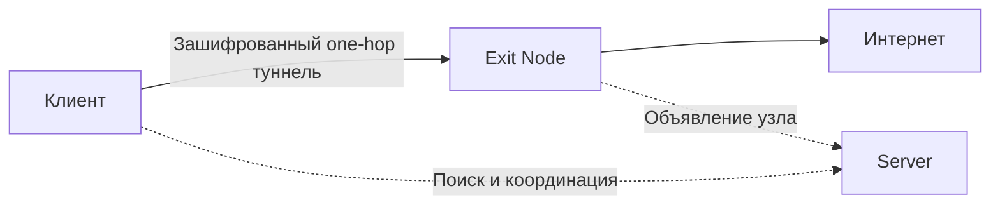

<h1 align="center">&nbsp;&nbsp;IRVIO PROJECT</h1>

<p align="center">
  <strong>OPEN SOURCE · ONE-HOP · PEER-TO-PEER VPN</strong>
</p>

<p align="center">
  
  
  
  
  <a href="LICENSE"></a>
</p>

<p align="center">
  Открытая распределённая сеть, в которой участники помогают друг другу получать доступ к интернету без единого центрального VPN-шлюза.
</p>

<p align="center">
  <a href="https://irvio.net">Сайт</a> ·
  <a href="#quick-start">Быстрый старт</a> ·
  <a href="#architecture">Архитектура</a> ·
  <a href="#contributing">Участие в проекте</a>
</p>

> [!WARNING]
> Подключаясь к IRVIO, вы не только используете чужую точку выхода, но и становитесь Exit Node для других участников. Их интернет-трафик может выходить через ваш публичный IP-адрес. Перед запуском ознакомьтесь с принципом работы сети, возможными рисками и применимым законодательством.

<a id="about"></a>

## Что такое IRVIO

IRVIO — бесплатная VPN-сеть с открытым исходным кодом. Вместо маршрута через инфраструктуру одного VPN-провайдера клиент устанавливает прямой зашифрованный туннель до выбранного участника сети — **Exit Node**. В интернет трафик выходит через подключение и публичный IP-адрес этого узла.

Служебная инфраструктура отделена от передачи пользовательских данных. Узлы **Server** помогают участникам обнаружить друг друга, пройти NAT и установить прямое соединение, но не являются промежуточными транзитными узлами между клиентом и отдельной Exit Node.

### Принцип участия

IRVIO не располагает собственной централизованной сетью точек выхода. Подключаясь к сети, участник получает доступ к Exit Node других пользователей и одновременно предоставляет сети собственное подключение. Именно этот взаимный обмен позволяет IRVIO оставаться бесплатной и распределённой.

Чужие точки выхода работают для вас — ваша точка выхода работает для других.

Проект находится на стадии **alpha**. Первая поддерживаемая платформа — **Ubuntu 24.04 LTS, AMD64**. Интерфейсы, протоколы и формат установки до стабильного релиза могут меняться.

<a id="architecture"></a>

## Как это работает



В IRVIO есть две функциональные роли. Один узел может выполнять одну или обе роли одновременно.

### Exit Node

Обычный участник сети. Он может использовать IRVIO для собственного трафика и одновременно предоставлять своё интернет-подключение другим участникам. Туннель завершается на Exit Node, после чего трафик выходит в интернет через её сетевое подключение.

### Server

Узел служебной инфраструктуры. Он участвует в peer discovery, Kademlia/DHT, Rendezvous и других координационных механизмах, которые помогают участникам найти друг друга и установить прямое соединение. Для стабильной доступности Server требуется публичный IP-адрес либо постоянно проброшенный входящий порт.

Server сам по себе не является relay между клиентом и отдельной Exit Node. При этом машина с ролью Server может одновременно публиковаться как Exit Node. Если клиент выбирает её точкой выхода, one-hop туннель завершается непосредственно на этой машине.

### Один выбор для пользователя

Пользователю не нужно вручную сравнивать IP-адреса и параметры узлов. Он выбирает страну выхода, после чего клиент получает доступных кандидатов, проверяет их со своего устройства и подключается к подходящей Exit Node.

Поиск участников не зависит от одного центрального сервера. Если соединение с кандидатом установить не удалось, клиент переходит к следующему доступному варианту.

<a id="technology"></a>

## Техническая основа

| Компонент | Назначение |
|---|---|
| **AmneziaWG** | Зашифрованный туннель на основе WireGuard с обфускацией |
| **go-libp2p** | Одноранговое сетевое взаимодействие и идентификация узлов |
| **Kademlia / DHT** | Распределённое обнаружение участников и объявлений узлов |
| **Rendezvous, STUN и ICE** | Поиск участников и установление соединения через NAT |
| **One-hop data plane** | Пользовательский трафик идёт напрямую от клиента к Exit Node |
| **systemd** | Управление daemon и серверной службой в Ubuntu |

Шифрование IRVIO защищает участок между клиентом и Exit Node. После выхода из туннеля действует обычная модель VPN: внешние сервисы видят IP-адрес точки выхода, а конфиденциальность прикладных данных по-прежнему зависит от HTTPS и других протоколов сквозного шифрования.

<a id="quick-start"></a>

## Быстрый старт

Скачивайте архив и файл контрольной суммы только со [страницы официальных релизов](https://github.com/Irviodotnet/Irvio/releases).

Проверьте SHA-256 перед распаковкой. Контрольная сумма подтверждает целостность скачанного файла, но сама по себе не подтверждает личность издателя.

Актуальные bootstrap-ссылка и QR-код опубликованы на [странице подключения к сети IRVIO](https://irvio.net/installation.html?lang=ru). Используйте только данные, опубликованные на официальном сайте проекта.

После проверки распакуйте архив и перейдите в его каталог.

### Клиент с UI

В терминале обычного пользователя:

```bash
sudo ./install.sh --user "$USER"
```

Установщик добавит необходимые зависимости, daemon, UI и системные службы. После установки выйдите из пользовательского сеанса и войдите снова, чтобы применилось членство в группе доступа.

Запустите **IRVIO** из меню приложений или командой:

```bash
irvio
```

Daemon запустится автоматически при открытии UI. Затем:

1. Импортируйте актуальную bootstrap-ссылку или QR-код.
2. Дождитесь получения списка доступных стран.
3. Выберите страну выхода.
4. Нажмите **CONNECT**.

Запускать daemon вручную не требуется.

> [!IMPORTANT]
> Не запускайте графический интерфейс через `sudo`. Импорт bootstrap-кода сам по себе не включает VPN: туннель запускается только после выбора страны и нажатия **CONNECT**.

### Server без UI

```bash
sudo ./install.sh \
  --role server \
  --bootstrap 'irvio-bootstrap:v1:<ПОЛНЫЙ_BUNDLE>'
```

Вместо `<ПОЛНЫЙ_BUNDLE>` подставьте полную актуальную bootstrap-ссылку с официальной страницы подключения.

Установщик добавит зависимости, настроит службу и её автозапуск, запустит Server и проверит его готовность. При успешной проверке он выведет:

```text
IRVIO server: OK
```

При ошибке установщик сообщит причину и предложит команды диагностики. Команда предназначена для новой установки: существующую неизвестную ручную установку installer намеренно не перезаписывает.

Подробная инструкция по установке, первому подключению и диагностике доступна [на сайте IRVIO](https://irvio.net/installation.html?lang=ru).

<a id="server-ports"></a>

## Сетевые порты Server

Стандартная серверная установка использует следующие внешние порты:

| Протокол и порт | Назначение |
|---|---|
| `TCP/4000` | Bootstrap / libp2p |
| `UDP/3478` | STUN |
| `UDP/51820` | ICE / AmneziaWG |

Активный UFW настраивается установщиком. Правила firewall в панели хостинг-провайдера необходимо разрешить отдельно. Нестандартные правила firewall установщик не перезаписывает.

Перед развёртыванием сверяйте таблицу с документацией конкретного релиза: сетевые параметры alpha-версий могут меняться.

<a id="diagnostics"></a>

## Диагностика

Основные журналы IRVIO находятся в **systemd journal**, а не в отдельном файле `irvio.log`.

Последние 100 записей клиентского daemon:

```bash
sudo journalctl -u hydrad.service -n 100 --no-pager
```

Наблюдение за клиентским daemon в реальном времени:

```bash
sudo journalctl -u hydrad.service -f
```

Последние 100 записей Server:

```bash
sudo journalctl -u irvio-server.service -n 100 --no-pager
```

Наблюдение за Server в реальном времени:

```bash
sudo journalctl -u irvio-server.service -f
```

Повторная проверка готовности установленного Server:

```bash
sudo /opt/irvio/scripts/check-server.sh
```

Перед публикацией диагностических журналов проверьте их содержимое: там могут находиться PeerID и сетевые адреса.

<a id="privacy"></a>

## Приватность и границы модели

IRVIO не использует единый центральный VPN-шлюз, но децентрализация сама по себе не означает абсолютную анонимность.

- Трафик между клиентом и выбранной Exit Node передаётся через зашифрованный туннель.
- После завершения туннеля действует стандартная модель VPN: Exit Node видит направления исходящих соединений, а внешние сервисы видят её публичный IP-адрес.
- Server обрабатывает служебные сообщения поиска и координации, но не является третьим транзитным узлом в соединении Client → Exit Node.
- Независимые операторы узлов контролируют собственные системы и политики журналирования.
- Локальные диагностические журналы могут содержать PeerID и сетевые адреса.

Не отправляйте в Issues журналы, дампы или другие диагностические данные, предварительно не проверив их содержимое.

<a id="project-status"></a>

## Статус проекта

IRVIO находится на стадии первого публичного Linux-релиза. Текущий фокус:

- клиент с UI для Ubuntu 24.04 LTS;
- headless Server для распределённой инфраструктуры;
- устойчивое обнаружение узлов и прямые P2P-соединения;
- расширение географии Exit Node и Server;
- проверка установки, обновления и восстановления после сбоев.

Поддержка Windows, macOS, Android и iOS находится в планах и будет добавляться по мере готовности соответствующих клиентов. Эти платформы пока не заявлены как поддерживаемые.

<a id="contributing"></a>

## Участие в проекте

Помочь IRVIO можно кодом, тестированием, документацией или предоставлением сетевой инфраструктуры.

### Запустить узел

Один из наиболее полезных вкладов — запустить постоянно доступный Server или Exit Node в своей стране. Это расширяет географию сети, упрощает обнаружение участников и повышает её устойчивость.

Оператор публичного узла должен самостоятельно обеспечить его обновление, корректную настройку firewall, наблюдение за состоянием и соблюдение применимых требований своей юрисдикции.

### Помочь разработкой

Мы приглашаем разработчиков присоединиться к IRVIO. Особенно полезен вклад в создание клиентов для **Windows, macOS, iOS и Android**, а также в тестирование, документацию и развитие сетевой инфраструктуры.

Перед первым Pull Request откройте Issue и кратко опишите предлагаемое изменение. Это позволит заранее согласовать архитектуру и избежать дублирования работы.

<a id="security"></a>

## Безопасность

Не публикуйте сведения об уязвимостях в открытых Issues. Для непубличного сообщения напишите на [irvio@proton.me](mailto:irvio@proton.me) и укажите в теме письма `SECURITY`.

<a id="license"></a>

## Лицензия

Исходный код IRVIO распространяется на условиях **GNU Affero General Public License v3.0**. Полный текст находится в файле [`LICENSE`](LICENSE).

## Контакты

- Сайт: [irvio.net](https://irvio.net)
- Репозиторий: [github.com/Irviodotnet/Irvio](https://github.com/Irviodotnet/Irvio)
- Email: [irvio@proton.me](mailto:irvio@proton.me)

---

<p align="center">
  <strong>IRVIO создаётся людьми и для людей.</strong><br>
  Чем больше участников — тем шире география и устойчивее сеть.
</p>
