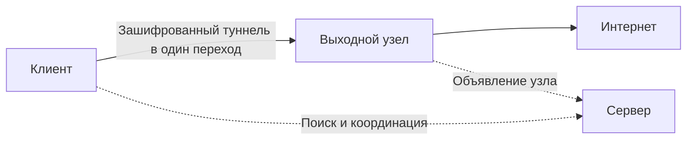
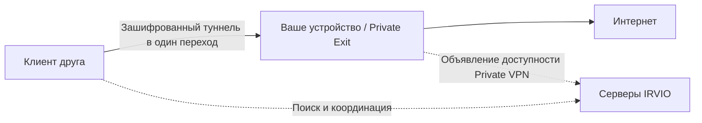

<h1 align="center">&nbsp;&nbsp;IRVIO PROJECT</h1>

<p align="center">
  <strong>OPEN SOURCE · ONE-HOP · PEER-TO-PEER VPN</strong>
</p>

<p align="center">
  
  
  
  
  
  <a href="LICENSE"></a>
</p>

<p align="center">
  Открытая распределённая сеть, в которой участники предоставляют друг другу доступ в Интернет — без центрального VPN-шлюза.
</p>

<p align="center">
  <a href="https://irvio.net">Сайт</a> ·
  <a href="#quick-start">Быстрый старт</a> ·
  <a href="#private-vpn">Private VPN</a> ·
  <a href="#architecture">Архитектура</a> ·
  <a href="#contributing">Участие в проекте</a>
</p>

<p align="center"><a href="README.md">English</a> · Русский</p>

Исходники: [Linux](Linux/source/) · [Windows](Windows/source/). Установщики: [релиз IRVIO 1.0](https://github.com/Irviodotnet/Irvio/releases/tag/v1.0.0). Версии пакетов и сведения о сборках: [примечания к релизу](RELEASE_NOTES.md).

> [!WARNING]
> В **Global VPN** при подключении ваше устройство также становится выходным узлом для других участников. Их трафик может выходить в Интернет через ваш публичный IP-адрес. В **Private VPN** вы отдельно выбираете: поделиться своим каналом с друзьями или подключиться к другу. Друзья, которым вы предоставили доступ, тоже выходят в Интернет через ваш публичный IP. Передавайте приглашения только тем, кому доверяете.

<a id="about"></a>

Bootstrap-ссылка сети — для знакомства с IRVIO, а не приглашение в Private VPN:

```text
irvio-bootstrap:v1:CAEaQQo0MTJEM0tvb1c5dnFiQTdNRm5MYkZQS3VWNTc1VTNtNXY1Tm00SDZMcml4UXkzUnFZNmV4cxIJCgTCVzSkEKAfGkEKNDEyRDNLb29XQXFKTVNGZTJ1MkxBa1JUQXdCenFXQUQ5TUZQejFrQ2tKdWt0QWJtakxEaG4SCQoEwHy16RCgHxpBCjQxMkQzS29vV1BFS3ZTV1BZc3FpZlZNcVBKYk1UY0xLR1E4bzljRkM2b3hzcDl1Z1RLaDJMEgkKBE4R0SkQoB8
```

## Что такое IRVIO?

Начните с нашего [манифеста](https://irvio.net/?lang=ru): он объясняет, зачем существует IRVIO!

IRVIO — бесплатная VPN-сеть с открытым исходным кодом. Вместо инфраструктуры одного VPN-провайдера клиент использует прямой зашифрованный туннель до другого участника — **выходного узла, или Exit Node**. Трафик выходит в Интернет через соединение и публичный IP-адрес этого узла.

Служебная инфраструктура отделена от пути пользовательского трафика. **Серверы** помогают участникам находить друг друга, проходить NAT и устанавливать прямое соединение. Они не становятся промежуточными транзитными узлами между клиентом и отдельным Exit Node.

### Два способа пользоваться IRVIO

| Режим | Что вы выбираете | Кто предоставляет выход в Интернет |
|---|---|---|
| **Global VPN** | Страну выхода | Подходящий выходной узел, найденный в сети |
| **Private VPN** | Сохранённое подключение к другу | Конкретный друг, который поделился своим каналом |

Оба режима работают в клиентах для **Ubuntu и Windows 11 (ну, тестировались на них, на Windows 10 тоже скорее всего заведется без проблем)** и используют прямой зашифрованный туннель в один переход. Клиент Windows может подключиться к Linux-хосту, и наоборот.

### Участие в Global VPN

IRVIO не принадлежит кому-либо, не управляет централизованным парком выходных серверов, поэтому подключаясь к сети, вы используете выходные узлы других участников и предоставляете свой интернет-канал взамен. Благодаря этому обмену сеть остаётся бесплатной и распределённой.

Чужие выходные узлы работают для вас; ваш — для других.

<a id="architecture"></a>

## Как это работает

У IRVIO две функциональные роли. Одно устройство может выполнять одну из них или обе одновременно. В целом достаточно простая архитектура, намеренно ее не усложняли, чтобы не пытаться стать вторым tor. Да и глубокая анонимизация, как таковая, не ставилась целью разработки.

### Global VPN



### Выходной узел — Exit Node

Это обычный участник сети. Он может использовать IRVIO для собственного трафика и одновременно предоставлять свой канал другим участникам. Зашифрованный туннель заканчивается на выходном узле, после чего трафик идёт в Интернет через его соединение.

### Сервер — Server

Сервер предоставляет распределённую служебную инфраструктуру IRVIO: участвует в поиске пиров, Kademlia/DHT, Rendezvous и других механизмах координации. Для стабильной доступности ему нужен публичный IP-адрес либо постоянное перенаправление необходимых входящих портов. Сервер не является ретранслятором между клиентом и отдельным выходным узлом. Но одна машина может работать и как Server, и как Exit Node. Если клиент выбирает её для выхода в Интернет, туннель заканчивается непосредственно на ней.

### Выбор выхода в Global VPN

Вам не нужно сравнивать IP-адреса и параметры узлов. Достаточно выбрать страну: клиент получит подходящих кандидатов, проверит их со своего устройства и подключится к доступному выходному узлу. Поиск не зависит от единственного центрального сервера. Если с одним кандидатом соединиться не удалось, клиент переходит к следующему доступному варианту.

<a id="private-vpn"></a>

## Private VPN — напрямую через Интернет друга

Private VPN нужен, когда вы уже знаете, к кому хотите подключиться. Вместо страны и публичного выходного узла вы выбираете приглашение от друга. Ваш трафик выходит через его интернет-соединение.



Как и в Global VPN, серверы помогают устройствам найти друг друга и установить соединение, а пользовательский трафик идёт напрямую между ними. При этом Private VPN по-прежнему использует инфраструктуру поиска IRVIO: это не автономный VPN без серверов. Возможность прямого соединения зависит от сетей и NAT с обеих сторон и не гарантируется в любых условиях (но по нашим прикидкам - 90% что все будет ОК, symmetric NAT может быть проблемой, но такое бывает не так уж и часто).

### Поделиться своим Интернетом

1. Установите IRVIO и импортируйте bootstrap-ссылку сети, если ещё этого не сделали (сама ссылка есть в шапке этого readme).
2. Откройте **Private VPN** и нажмите **Share my internet**.
3. В окне приглашения скопируйте ссылку или сохраните QR-код. Передайте его другу лично.
4. Оставьте IRVIO работающим, а раздачу — включённой. Когда друг подключится, его подключение появится на этом экране.
5. Если есть какой-то Linux хост (VDS, виртуалка постоянно работающая и т.д.) то можно использовать ключ **--persistent** для постоянной работы Exit node на этом узле, даже после перезагрузки.

Приглашение можно использовать в течение **одного часа**. Первое устройство, которое воспользуется им, получит доступ автоматически — отдельного подтверждения не требуется. Ссылка и QR-код дают право доступа, поэтому не публикуйте их в открытых чатах.

Часовой срок относится к **первому использованию приглашения**, а не к сохранённому разрешению. После этого друг сможет подключаться повторно без новой ссылки, пока вы раздаёте канал и не отозвали его доступ.

**Invite another friend** создаёт новое приглашение. **Stop sharing** останавливает текущую раздачу. **Revoke access** отзывает у конкретного друга разрешение пользоваться вашим каналом.

### Подключиться к Интернету друга

1. Установите IRVIO и импортируйте bootstrap-ссылку сети для доступа к инфраструктуре поиска (ссылка есть в шапке этого readme).
2. Откройте **Private VPN → Connect to a friend**.
3. Вставьте приглашение друга или нажмите **Import QR image**, затем **CONNECT**.
4. Дождитесь **CONNECTED**. Теперь ваш трафик выходит в Интернет через канал друга.

Подключение сохранится в выпадающем списке с сокращённым PeerID. В следующий раз достаточно выбрать его и нажать **CONNECT** — повторно использовать исходное приглашение не нужно. **DISCONNECT** вернёт обычное интернет-соединение.

Чтобы удалить сохранённое подключение к другу со своего устройства, откройте соответствующий блок удаления профиля друга в **Settings**. Это отдельная операция: она не равнозначна удалению основного профиля IRVIO или отзыву доступа на устройстве раздающего.

### Что именно получает друг?

Режим предоставляет **выход в Интернет**, а не доступ к вашей локальной сети, файлам, RDP или VNC. Он не превращает домашнюю сеть друга в сеть удалённого доступа.

В текущем UI действия разделены: Global VPN с участием в раздаче, подключение к другу или отдельная приватная раздача. Пока вы подключены к другу, кнопка **Share my internet** недоступна. Private VPN не строит цепочку из нескольких VPN-переходов.

### Раздача ссылок для подключения к IRVIO

В случае если надо поделиться IRVIO или дать ссылку на подключение к сети - не стоит пользоваться этим репозиторием, bootstrap серверов много, часто меняется их состав, актуальный перечень доступных серверов можно передать другому человеку, для этого стоит в UI перейти на страницу **Share IRVIO** и сгенерировать новый qr-код или bootstrap ссылку на подключение к сети, а уже ее передать кому нужно.

<a id="privacy"></a>

## Приватность и границы модели

IRVIO не использует единый центральный VPN-шлюз.

- Между клиентом и выбранным выходным узлом трафик идёт по зашифрованному туннелю.
- За пределами туннеля действует обычная VPN-модель: выходной узел может видеть адреса назначения, а внешние сервисы видят его публичный IP.
- Сервер обрабатывает поиск и координацию, но не становится третьим транзитным узлом в соединении «клиент → выходной узел».
- Независимые операторы самостоятельно управляют своими системами и политикой журналирования.
- Локальные диагностические журналы могут содержать PeerID и сетевые адреса.
- Private VPN позволяет выбрать доверенного оператора выхода, но не делает трафик невидимым для него и не заменяет HTTPS. Приглашения и QR-коды нужно хранить в тайне.

Не публикуйте логи, дампы и другие диагностические данные в Issues, не проверив их содержимое.

<a id="technology"></a>

## Техническая основа

| Компонент | Назначение |
|---|---|
| **AmneziaWG** | Зашифрованный туннель на основе WireGuard с обфускацией |
| **go-libp2p** | P2P-связь и идентичность узлов |
| **Kademlia / DHT** | Распределённый поиск участников и объявлений узлов |
| **Rendezvous, STUN и ICE** | Поиск пиров и установка соединений через NAT |
| **Передача в один переход** | Трафик идёт напрямую от клиента к выходному узлу |
| **systemd** | Управление демоном и серверной службой в Ubuntu |
| **Службы Windows / WFP** | Жизненный цикл демона и ProtectedMode в Windows |

Шифрование IRVIO защищает участок между клиентом и выходным узлом. После выхода из туннеля внешние сервисы видят IP этого узла, а конфиденциальность содержимого по-прежнему зависит от HTTPS или другого сквозного шифрования на уровне приложения.

<a id="quick-start"></a>

## Быстрый старт

Он действительно быстрый! Для начала скачайте актуальный релиз для своей платформы, ну а далее развилка!

### Клиент с UI в Ubuntu

Распакуйте tarball и из терминала обычного пользователя выполните:

```bash
sudo ./install.sh --user "$USER"
```

Установщик добавит зависимости, daemon, UI и системные службы. Открыть IRVIO можно сразу: выходить из сеанса или перезагружаться не нужно. Local API socket доступен выбранному UID пользователя, который daemon дополнительно проверяет через SO_PEERCRED. Далее просто откройте **IRVIO** из меню приложений или выполните:

```bash
irvio
```

Daemon запустится автоматически при открытии UI. Далее:

1. Импортируйте актуальную bootstrap-ссылку сети или QR-код (в шапке этой страницы есть ссылка).
2. Откройте **Global VPN** и дождитесь списка стран.
3. Выберите страну выхода.
4. Нажмите **CONNECT**.

Запускать daemon вручную не требуется.

> [!IMPORTANT]
> Не запускайте UI через `sudo`. Импорт bootstrap-кода сам по себе не включает VPN: туннель поднимается после выбора страны и нажатия **CONNECT**.

### Клиент с UI в Windows 11

1. Скачайте Windows x64 установщик выбранной сборки и проверьте его контрольную сумму.
2. Запустите установщик и подтвердите запрос прав администратора для установки daemon, драйвера и системных компонентов.
3. Откройте **IRVIO** через меню «Пуск» от обычного пользователя или с рабочего стола, если в инсталляторе указали разместить ярлык Irvio там.
4. Импортируйте bootstrap-ссылку сети или QR-код (все там-же, код есть в шапке этого readme).
5. Выберите страну в **Global VPN** либо откройте **Private VPN**, чтобы раздать свой канал или подключиться к другу.

Вручную запускать daemon или постоянно держать UI с правами администратора не нужно. Windows-установщик может быть неподписанной preview-сборкой: смотрите описание конкретной версии, не предполагая наличия подписи издателя, автоматического обновления или восстановления установки. Перед удалением или заменой завершите приложение через **Shutdown IRVIO**.

### Ubuntu: приватная раздача без открытого UI (временная)

После установки IRVIO для своего пользователя выполните от его имени один из вариантов:

```bash
irvio --mode client --bootstrap 'irvio-bootstrap:v1:<FULL_BUNDLE>'
irvio --mode client --bootstrap /path/to/bootstrap.txt
irvio --mode client --bootstrap /path/to/bootstrap-QR.png
```

Замените `<FULL_BUNDLE>` полной bootstrap-ссылкой сети, а пути — своими. Можно передать саму ссылку, текстовый файл или QR-изображение PNG/JPEG. Команда включает **Share my internet**, а не Global VPN. Установленный daemon запускается через Local API; консольный бинарник не заменяет установку daemon и служб. В текущем каталоге появится файл `irvio-invitation-<номер>.txt`, доступный только владельцу. Отправьте ссылку из файла другу: как и в UI, приглашение действует час и выдаёт доступ первому использовавшему его устройству.

Оставьте команду работающей на время раздачи. **Ctrl+C** штатно остановит раздачу, не удаляя профиль и разрешения друзей. Следующий запуск создаст новый файл приглашения. Принудительное завершение консоли не отключает daemon — в таком случае остановите раздачу через UI. Не управляйте одной сессией одновременно из консоли и UI.

### Ubuntu: приватная раздача без открытого UI (постоянная)

Некий псевдо-VPN без необходимости обязательного белого-IP адреса.

Все тоже самое, как приватная раздача без открытого UI (временная, только с дополнительным ключом запуска `--persistent`). Все также сгенерируется ссылка, передаете ее другу, далее терминал можно выключать - демон и все нужные службы будут работать, после перезагрузки (если таковая случится по какой-то причине) все поднимется автоматически и раздача интернета для друга восстановится.

### Сервер без UI

Для начала - сервер это сущность, на которой держится вся сеть. Чем больше серверов - больше надежность сети, как правило сервер не передает клиентский трафик за исключением 1 случая - если этот сервер единственная Exit node в стране. Тогда да, сам сервер будет передавать трафик от пользователей кто выбрал эту страну как Exit узел.

Инсталляция простая:

```bash
sudo ./install.sh \
  --role server \
  --bootstrap 'irvio-bootstrap:v1:<FULL_BUNDLE>'
```

Замените `<FULL_BUNDLE>` полной актуальной bootstrap-ссылкой с официальной страницы подключения.

Установщик добавит зависимости, настроит службу и её автозапуск, запустит сервер и проверит готовность. При успехе появится:

```text
IRVIO server: OK
```

При проблеме установщик покажет причину и команды диагностики. Это команда для новой установки: неизвестное ручное развёртывание он намеренно не перезаписывает.

<a id="server-ports"></a>

## Сетевые порты сервера

Стандартная серверная установка использует следующие внешние порты:

| Протокол и порт | Назначение |
|---|---|
| `TCP/4000` | Bootstrap / libp2p |
| `UDP/3478` | STUN |
| `UDP/51820` | ICE / AmneziaWG |

Установщик настраивает UFW, если тот активен. Если у хостинг-провайдера есть отдельный firewall, разрешите эти порты и там. Нестандартные правила firewall установщик не перезаписывает.

Перед развёртыванием сверьтесь с документацией конкретного релиза: на стадии alpha сетевые параметры ещё могут меняться.

<a id="diagnostics"></a>

## Диагностика

В **Ubuntu** основные логи IRVIO находятся в **systemd journal**, а не в отдельном `irvio.log`. Команды ниже относятся к Ubuntu, не к Windows. На обеих платформах начать можно с экрана **Diagnostics** и инструкции к своей сборке.

Последние 100 записей клиентского daemon:

```bash
sudo journalctl -u irviod.service -n 100 --no-pager
```

Логи клиентского daemon в реальном времени:

```bash
sudo journalctl -u irviod.service -f
```

Последние 100 записей сервера:

```bash
sudo journalctl -u irvio-server.service -n 100 --no-pager
```

Логи сервера в реальном времени:

```bash
sudo journalctl -u irvio-server.service -f
```

Повторная проверка готовности сервера:

```bash
sudo /opt/irvio/scripts/check-server.sh
```

Перед публичной отправкой проверьте логи: в них могут быть PeerID и сетевые адреса.

<a id="contributing"></a>
<a id="project-status"></a>

## Как помочь проекту

Помочь можно кодом, тестированием, документацией или сетевой инфраструктурой.

### Запустить узел

Один из самых полезных вкладов — постоянно доступный сервер или выходной узел в вашей стране. Это расширяет географию сети, улучшает поиск пиров и повышает устойчивость IRVIO.

Оператор публичного узла отвечает за обновления, корректную настройку firewall, контроль работоспособности и соблюдение применимых законов и требований.

### Участвовать в разработке

Будем рады разработчикам, которым интересен IRVIO. Особенно полезны улучшения клиентов Linux и Windows, работа над будущими клиентами **macOS, iOS и Android**, тестирование, документация и инфраструктура.

Перед первым Pull Request создайте Issue с коротким описанием изменения: так проще согласовать подход и не дублировать работу.

<a id="contact"></a>
<a id="security"></a>

## Контакты

- Сайт: [irvio.net](https://irvio.net)
- Репозиторий: [github.com/Irviodotnet/Irvio](https://github.com/Irviodotnet/Irvio)
- Почта: [irvio@proton.me](mailto:irvio@proton.me)

---

<p align="center">
  <strong>IRVIO создаётся людьми для людей.</strong><br>
  Чем больше участников, тем шире и устойчивее сеть.
</p>
